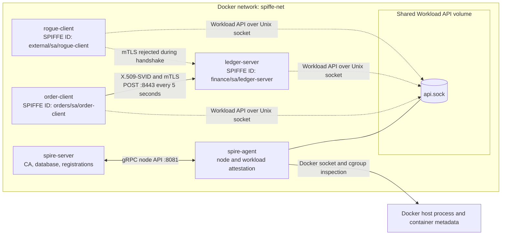

# SPIFFE mTLS Echo Lab: Architecture and Getting Started

This guide explains what the lab runs, how a request travels through it, and how to start and inspect it. It assumes you are new to SPIFFE, SPIRE, and mutual TLS (mTLS).

## What you will learn

When the lab is running, two small Go programs communicate over HTTPS. SPIRE gives each program a short-lived X.509 identity called an **SVID**. The programs get their SVIDs from a local Unix socket and keep them in memory. They do not load application certificates or private keys from files.

The server accepts only the client identity `spiffe://lab.local/ns/orders/sa/order-client`. A second, deliberately unauthorized workload demonstrates that a valid identity from the same trust domain is still rejected when it is not on the allowlist.

## Architecture at a glance



The SPIRE Server is the trust authority for the `lab.local` trust domain. The SPIRE Agent runs beside the workloads and exposes the Workload API socket. The agent uses Docker metadata, including each container's `app` label, to decide which registration entry matches a connecting process.

The Compose labels are the workload selectors:

| Container | SPIFFE ID | Docker selector | Server authorization |
|---|---|---|---|
| `ledger-server` | `spiffe://lab.local/ns/finance/sa/ledger-server` | `docker:label:app:ledger-server` | Server identity expected by the client |
| `order-client` | `spiffe://lab.local/ns/orders/sa/order-client` | `docker:label:app:order-client` | Allowed caller |
| `rogue-client` | `spiffe://lab.local/ns/external/sa/rogue-client` | `docker:label:app:rogue-client` | Rejected caller |

The `ns` and `sa` path pieces are descriptive parts of the SPIFFE ID in this Docker lab. They do not mean that Kubernetes namespaces or service accounts are running.

## Main components

### SPIRE Server

`conf/server/server.conf` configures the `lab.local` trust domain, an SQLite datastore, a disk-backed server key manager, and a 120-second default X.509-SVID lifetime. It listens on port `8081` for the agent API. The server's database and signing keys live in the `spire-server-data` Docker volume.

### SPIRE Agent

`conf/agent/agent.conf` configures the agent to join the server with a one-time token and to expose `/tmp/spire-agent/public/api.sock`. Its Docker workload attestor reads process/container metadata through the Docker socket and resolves the `app` label. The API socket is shared with the applications through the `workload-api` volume.

### Go workloads

- `cmd/ledger-server` gets its X.509-SVID and trust bundle from the Workload API. It serves `POST /api/v1/entries` over HTTPS on port `8443`. Its TLS configuration requires a client SVID and authorizes only the configured `ALLOWED_CLIENT_ID`.
- `cmd/order-client` gets its own SVID from the same API. Every five seconds it posts `{"amount":100,"currency":"EUR"}` and requires the server identity configured by `EXPECTED_SERVER_ID`. It opens a new TLS connection for each request so logs make certificate rotation easy to see.
- `rogue-client` runs the same client program with the rogue Docker label. SPIRE gives it a valid SVID, but the ledger server refuses its identity.

The application containers run as the non-root `65532` user. The SPIRE containers run as root in this local Compose setup so the agent can use the Docker socket and the SPIRE processes can initialize their persistent volumes. The agent also uses the host PID namespace to map workload processes to Docker containers.

## Important terms

- **SPIFFE ID:** A URI that names a workload, for example `spiffe://lab.local/ns/orders/sa/order-client`.
- **Trust domain:** The SPIFFE authority that issues and validates identities. Here it is `lab.local`.
- **SVID:** A short-lived, cryptographically signed credential containing a workload's SPIFFE ID. This lab uses X.509-SVIDs.
- **Workload API:** The local SPIRE Agent API through which a workload receives its SVID and trust bundle. Here it is a Unix socket, not a network port.
- **Attestation:** SPIRE's process of checking that a node or workload matches an allowed identity registration before issuing an SVID.
- **mTLS:** TLS where the client and server both present credentials and verify the other side.
- **Selector:** A property SPIRE checks when matching a running workload to a registration, such as the Docker label `app=order-client`.

## Flows

### 1. Starting and registering the lab

1. `make up` runs `scripts/bootstrap.sh`.
2. The script starts the SPIRE Server and waits for its health check.
3. It reads the one-time join token from the local `.env` file, or creates one on the first run. The token is passed to the agent. `.env` is ignored by Git because it contains bootstrap state.
4. The script registers the ledger, order, and rogue workload IDs as children of the join-token agent ID, each with its matching Docker label selector. Existing entries with the same SPIFFE ID are replaced so the script can be run again.
5. Compose starts the agent and applications. The agent attests to the server and begins serving the Workload API socket.

The token is for bootstrapping the SPIRE Agent. The Go applications do not receive or use it. Their application configuration contains the Workload API socket address, not TLS credentials.

### 2. Workload identity issuance

When a Go process starts, `workloadapi.NewX509Source` connects to `unix:///tmp/spire-agent/public/api.sock` and waits for an initial SVID. The agent inspects the caller's container metadata, sees its `app` label, and matches it to a registration entry. It then provides the workload's X.509-SVID and the trust bundle in memory.

The resulting identities are:

- Ledger: `spiffe://lab.local/ns/finance/sa/ledger-server`
- Order: `spiffe://lab.local/ns/orders/sa/order-client`
- Rogue: `spiffe://lab.local/ns/external/sa/rogue-client`

### 3. Authorized HTTPS request

```mermaid
sequenceDiagram
    participant O as order-client
    participant OA as SPIRE Agent / Workload API
    participant L as ledger-server
    participant LS as SPIRE Agent / Workload API

    O->>OA: Get active SVID and trust bundle over Unix socket
    OA-->>O: order-client X.509-SVID and bundle
    L->>LS: Get active SVID and trust bundle over Unix socket
    LS-->>L: ledger-server X.509-SVID and bundle
    O->>L: TLS ClientHello; present order-client SVID
    L->>O: Present ledger-server SVID
    Note over O,L: Each side verifies the certificate chain and exact peer SPIFFE ID
    O->>L: POST /api/v1/entries with JSON body
    L-->>O: 200 JSON with both SPIFFE IDs and client serial
```

The client checks that the server ID is exactly `spiffe://lab.local/ns/finance/sa/ledger-server`. The server checks that the client ID is exactly `spiffe://lab.local/ns/orders/sa/order-client`. Both checks occur as part of TLS authentication, before the HTTP handler receives the request.

### 4. Unauthorized workload

The rogue workload also obtains an SVID, so its certificate is trusted as belonging to `lab.local`. However, its SPIFFE ID is not the one allowed by the ledger server. The TLS handshake fails with an authorization error such as `remote error: tls: bad certificate`. The server does not process the HTTP body.

### 5. Certificate rotation

The default X.509-SVID TTL is 120 seconds. The Workload API source streams updates, and the Go TLS configuration reads the current SVID from that source. SPIRE renews SVIDs before expiration; in the observed run, the order client's serial changed shortly after one minute while requests continued returning `200 OK`. The client disables HTTP keep-alive so each five-second request negotiates TLS with the current SVID.

## Getting started

### Prerequisites

- Docker Desktop running, or a Docker Engine with Docker Compose v2.
- `make` available in your terminal.
- Network access to pull the SPIRE, Go, and distroless images and Go modules on the first build.
- Host ports `8081` and `8443` available.

You do not need to install Go locally; the Docker build compiles the Go applications.

### Start the stack

From the project directory:

```sh
make up
```

The first run downloads images and compiles the programs, so it can take a few minutes. The script creates a local `.env` file for the SPIRE join token. Keep that file private and do not commit or share it. It is ignored by the included `.gitignore`.

Check container status:

```sh
docker compose ps
```

Follow the application logs:

```sh
make logs
```

Within a few seconds, `order-client` should log lines like:

```text
serial=... peer=spiffe://lab.local/ns/finance/sa/ledger-server status=200 OK latency=...
```

The ledger response body includes `status`, `server_spiffe_id`, `client_spiffe_id`, and the client certificate serial.

### Try the unauthorized identity

Run:

```sh
make rogue
```

The rogue client should log `remote error: tls: bad certificate`. At the same time, the ledger logs a TLS handshake error with `unexpected ID "spiffe://lab.local/ns/external/sa/rogue-client"`. That error is the expected result of this test.

`make rogue` keeps sending requests every five seconds. To stop it, press Ctrl+C. If the one-off Compose container remains afterward, run `docker compose ps -a`, find its `rogue-client` container name, and remove it with `docker rm -f <container-name>`.

### Observe rotation

Leave the client logs running for at least 90 seconds:

```sh
make logs
```

Compare the `serial=` value over time. It should change as the SVID rotates, while the client continues logging `200 OK`. You can also inspect agent renewal messages:

```sh
docker compose logs spire-agent
```

### Stop the stack

```sh
make down
```

This stops and removes the containers and network but keeps the named data volumes and `.env`, so a later `make up` can reuse the existing SPIRE state. A full reset requires deleting the persistent volumes and `.env`; doing so removes the local CA/database/agent state and means the identities must be bootstrapped again.

To fully reset this disposable local lab, run:

```sh
docker compose down -v
rm -f .env
make up
```

This permanently deletes the lab's local SPIRE database, signing keys, and agent state. Do not use it if you want to preserve this lab's current trust domain state.

The HTTPS port is published as `localhost:8443`, but a normal browser or `curl` request will not succeed because the endpoint requires a SPIFFE client identity. Use `order-client` to make an authorized request; that is the purpose of its logs and response output.

## Troubleshooting

### `permission denied` connecting to Docker

Make sure Docker Desktop is running and that the local Codex/terminal execution environment is allowed to access Docker. This lab needs access to the Docker daemon because the agent uses Docker workload attestation.

### SPIRE Server says it cannot open the SQLite database

Check that the `spire-server-data` volume is mounted and that the SPIRE server container can write to it. The Compose service is configured to run the SPIRE Server as root to initialize its local lab data volume.

### SPIRE Agent reports it cannot parse the Docker host

The agent config expects the Docker socket address in URI form: `unix:///var/run/docker.sock`. Check that the socket is mounted into the agent container and Docker Desktop is running.

### A workload says no identity is issued

Check these items:

1. `docker compose ps -a` shows the server and agent running.
2. The agent log says node attestation succeeded and the Workload API started.
3. The workload container has the expected `app` label in `docker-compose.yml`.
4. The registration entry uses the same selector and the current agent parent ID. Re-run `make up` to bootstrap registrations.

### Client gets `connection refused`

Check that `ledger-server` is running and listening on port `8443`, and that both workloads are on `spiffe-net`.

### Client gets `tls: bad certificate`

For `rogue-client`, this is expected. For `order-client`, check its `app` label, SPIRE registration, and the `ALLOWED_CLIENT_ID` / `EXPECTED_SERVER_ID` values.

## Local-lab security boundaries

This setup is intended for local learning, not production deployment. Agent bootstrap skips server certificate verification (`insecure_bootstrap = true`), the agent can access the Docker daemon socket, and the SPIRE Agent shares the host PID namespace to identify container workloads. Treat Docker daemon access and the generated `.env` bootstrap token as sensitive. Do not expose the SPIRE API or workload socket outside this local lab.

## Repository map

```text
cmd/ledger-server/main.go  HTTPS API and client SPIFFE ID authorization
cmd/order-client/main.go   periodic mTLS client and peer identity logging
conf/server/server.conf    SPIRE Server trust domain, datastore, and TTL
conf/agent/agent.conf      SPIRE Agent and Docker workload attestor
scripts/bootstrap.sh       server startup, join token, and workload entries
docker-compose.yml         services, labels, shared socket, and network
Dockerfile                 static Go binaries in a small non-root image
Makefile                   up, down, logs, and rogue commands
```
